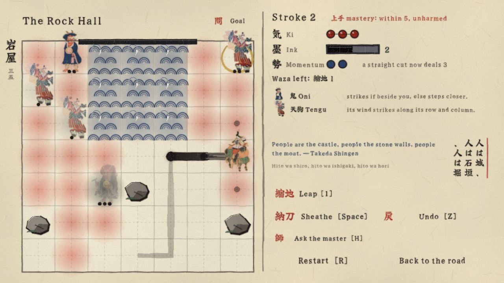

# Jōzu 上手

A puzzle RPG of single brush strokes, set among the yokai of Heian-era Japan.

The look comes from real Japanese painting: Hasegawa Tōhaku's *Pine Trees* behind the title,
Sesshū's Long Scroll unrolling above the road map, and the Muromachi *Hyakki Yagyō Emaki*
(the Night Parade scroll the story is about) behind the dialogue. All are public domain
(see `art/CREDITS.md`). Text is set in Yuji Syuku, a brush-written typeface (SIL OFL, `fonts/OFL.txt`).
The pieces on the board are figures lifted from old paintings too: Tomoe Gozen as Suzu, Ōtsu-e and
Kyōsai oni, Sōjōbō the tengu, the fox and ghost of the *Bakemono no e* scroll, Hokusai's nine-tailed fox
and Sekien's lantern ghost. The board and UI are brushed in code and passed through a paint shader that adds ink bleed,
dry-brush breakup and paper grain.

Open the folder in **Godot 4.7** or later and press Play, or run the line below.
Export presets for a single Windows executable and for the web are included.

    godot --path .

Music: a 1920s shakuhachi recording of *Shika no Tōne* under the story, *Sakura Sakura* on synthesised
koto for the title and road, and original pieces composed in code (`tools/make_audio.py`) in the
miyako-bushi scale for the stages: three for koto and drum that take turns by chapter, two for
shamisen and taiko on the last board of a story, and a sparse one for flute, koto and bell in the
chapters of stillness. Press `M` to mute.

586 stations in thirty-seven chapters. Ten chapters tell the story; twenty-seven more each explore one
puzzle style, yokai, kind of weather or piece of ground, or a mixture of them, in a rising ladder of
eighteen boards. The story stages are hand-made;
the rest come from a generator (`tools/gen`, C#) that builds candidate boards, solves them exactly,
scores their difficulty and keeps an evenly climbing run. `tools/verify.gd` replays every stored
solution through the real rules, so each station is proven masterable at base stats, and
`tools/playtest.gd` drives the real screens through the whole game.

Stages without story carry a traditional saying chosen to fit their own board and answer: proverbs,
Zen phrases and kōan, haiku, and words from Buddhist teachers, samurai and the old chronicles. Each
chapter has a line of history about its place on the road map.

## How it plays

Each turn you paint **one stroke**: up to four tiles of steps and cuts, never crossing your own ink.
Then every yokai answers, exactly as the red wash on the board predicted. Nothing is random.

- **Momentum 勢** — each straight step before a cut adds 1 damage (1 / 2 / 3). Distance is your weapon.
- **Later chapters** add ice (you slide until stopped, gathering momentum), fire (burns if you rest on it),
  umbrella yokai that hop two tiles, kappa that hunt from the water, wall yokai that must be broken,
  and a skeleton that strikes all eight tiles around it.
- **Style chapters:** kōan 公案 (one stroke only), stone garden 石庭 (rake every tile in one stroke),
  the gate 鳥居 (arrive; nothing need be cut), wet ink 墨 (your last stroke is a wall for one turn),
  ensō 円相 (close a circle to bind what is inside), ink stone 硯 (unspent ink is kept) and
  no sword 無刀 (the brush cannot cut).
- **More yokai:** daruma 達磨 (a blow only topples it; it rises again), tanuki 狸 (a stone until you rest
  beside it), hitodama 人魂 (soul-flames on a red thread that relight while one still burns) and the
  shinigami 死神 (passes through anything; one touch is the end).
- **Weather and hour:** wind 風 carries light yokai a tile each turn, rain 雨 puts out lanterns and fire and
  lets kappa ashore, deep snow 雪 freezes all water, and at night 夜 you see only near yourself and near light.
- **Shikigami 式神:** a yokai bound by your circle goes into your hand and can be set down as an ally that
  holds its tile and strikes what stands within its reach.
- **The road beyond** (after the scroll ends): offerings 供 that walking yokai go to and stop to eat;
  the temple bell 鐘, rung once, which stills every yokai for a turn; plank bridges 橋 that fall in behind
  you with whatever followed; spider webs 巣 that end your stroke; the kamaitachi 鎌鼬, which runs three
  tiles a turn; numbered seals 封, so that yokai can only be felled in order; and writing 書, where the
  board is a character and you paint every tile of it (fifty-odd characters over two chapters, ending
  on 上 and 手). Three chapters mix them: the lure (offerings and bridges), the storm (wind, bell and
  weasel) and the knot (seals among webs).
- **Other roads** 別 (from the map): a **daily kōan**, the same board for everyone, gentle on Monday and
  hardest on Sunday, with a calendar of past days and a result line to copy; the **88 temples**, a pilgrimage with no undo, no hints and three staffs; and the
  **workshop**, where you lay out a board, clear it, and get a short code anyone can paste to play it.
  The **unmapped road** makes a new board while you wait, in one of four brackets of difficulty: in the
  browser the generator and solver themselves run beside the game (`tools/genweb`, the C# of `tools/gen`
  compiled to WebAssembly, in a web worker), and every board they hand over is replayed through the game's
  own rules before it is shown. If none turns up in time, or outside the browser, a board comes from a
  shelf of some 1,500 proven boards the story never used. Each has a code to pass on.
- **Brushwork:** the title is written out stroke by stroke; an ink wash turns one screen into the next;
  stage names are brushed in; the seal is stamped; and the strokes that cleared a stage are written out
  again on the result and in your scroll. The seasons drift over the title and the road (petals,
  fireflies, maple leaves, snow); painted sliding doors open onto each stage; yokai gather out of ink
  and come apart into it; a cleared stage hangs as a scroll; sayings are set top to bottom; wooden
  clappers open and close a scene. All of the motion stops with Motion off.
- **On a phone:** pinch with two fingers to zoom and drag with two to move about, or tap 拡 on the left
  edge. Each stage opens with a large card giving the goal and anything met there for the first time;
  it goes by itself or at a tap, and 問 brings it back.
  Every screen has a phone layout of its own: larger type and buttons, the chapters on a page of
  their own instead of a row of tabs, and the workshop's palette in four pages of large buttons.
- **Settings** 設: sound, music, motion, a cross on danger tiles that does not rely on colour, the
  painted look, and how strokes may be taken back: within the stroke in hand (a sheathed stroke is committed), or never.
  **Style** chooses between Shodō, the default (bare paper, one seal, a stroke that pools where the
  brush comes down, pales as its ink is spent and runs dry at the end; the board ruled as a practice
  sheet under a paperweight; the stage signed down the left margin; earlier strokes drying to grey; ink
  in an inkstone; a teacher's red circle on a clear) and Ornate (gold clouds,
  drifting seasons, seals and frames throughout).
- **Three seals a station:** 上手 mastery, 潔 mastery at the first attempt since entering the stage (no
  undo, no restart), 惜墨 sparing of ink. Seals earn the
  kyū and dan ranks, from 10th kyū to meijin.
- **Ask the master** (`H`) shows the next stroke of a known solution. **Your scroll** 巻 keeps the strokes
  that cleared each station, with the board taken away.
- **Red tiles** — where you would be struck if you sheathed the brush there.
- **Waza** learned on the road: 縮地 leap over a tile, 結界 paste a ward, 喝 shout yokai away (into water, they are gone).
- **上手 seal** — clear a station unharmed within the mastery stroke count. Always possible with no upgrades.
- **The gate 関** — the last station of a chapter opens once two-thirds of the chapter carries the 上手 seal. Every other station opens when the one before it is passed.
- **Training 修練** — points from stations buy ink, ki and extra waza uses. Help for the road, never required.

Controls: click / drag / arrow keys to paint, `Space` sheathe, `Z` or right-click take back a step of the stroke in hand, `R` restart, `1 2 3` waza, `4` shikigami, `5` bell, `H` ask the master.

## Files

- `scripts/sim.gd` — the rules, pure and deterministic
- `scripts/data.gd` — every station, story and text. The legend and upgrades at its top are written by hand; the chapters and stations below them are written by `tools/build_levels.py`
- `scripts/extra.gd` — boards outside the story: the daily kōan, the 88 temples, the unmapped road (generated)
- `scripts/ink.gd` — brushwork drawn in code
- `shaders/paint.gdshader` — ink bleed, dry brush and paper grain over the whole frame
- `art/`, `fonts/` — public-domain paintings and the bundled typeface
- `tools/build_web.sh` — builds the web version into `build/web` (re-trims the font first); `tools/publish_pages.sh` pushes it to GitHub Pages
- `tools/engine/web_nothreads_release.zip` — the web engine the game ships with: Godot 4.7.2 compiled without the parts it never uses, about half the size of the stock one. `tools/build_engine.sh` rebuilds it (only needed when the Godot version changes)
- `tools/web_shell.html` — the web build's loading page (paper, the name, a brush stroke for progress); `art/splash.png` and `art/icon.png` are the splash and the icon
- `tools/subset_font.py` — trims the typeface to the characters the game uses (the full font is in `fonts/src/`)
- `tools/make_audio.py` — regenerates the synthesised music (Ogg Vorbis) and sound effects (needs numpy and soundfile)
- `tools/gen/` — level generator and exact solver (.NET 8). `python tools/build_levels.py` assembles the stations from
  `tools/story_stages.json` (hand-written stages), `hand_solved.json` (their solutions), `generated.json`, `pool.json`
  and `daily_pool.json` (generated boards)
- `tools/genweb/` — the same generator compiled to WebAssembly for the unmapped road (.NET 10 with the `wasm-tools` workload)
- `tools/playtest.gd` — automated playthrough of the real screens: `godot --headless --path . -s tools/playtest.gd`
- `tools/verify.gd` — replays every stage's stored solution: `godot --headless --path . -s tools/verify.gd`
- `tools/shots.gd` — renders the screenshots in `docs/`

## Licence

Code, stage data, story text and synthesised audio: MIT (see `LICENSE`).
The bundled paintings, typeface and shakuhachi recording keep their own terms; see `art/CREDITS.md`
and `fonts/OFL.txt`.
